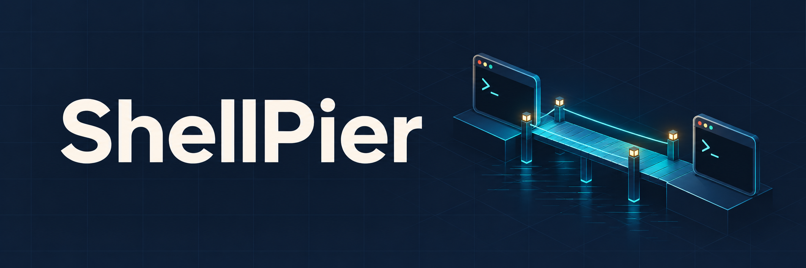

<p align="center">
  
</p>

<p align="center"><strong>让自己的 AI Agent，临时连上另一台电脑。</strong></p>

<p align="center">
  简体中文 · <a href="README.en.md">English</a>
</p>

<p align="center">
  <a href="https://github.com/Boulea7/shellpier/releases"></a>
  <a href="https://github.com/Boulea7/shellpier/actions/workflows/ci.yml"></a>
  <a href="go.mod"></a>
  <a href="LICENSE"></a>
</p>

ShellPier 让自己的 AI Agent 临时执行另一台电脑上的命令、传输文件；解压后即可运行，使用当前用户权限。

## 下载与使用

从 [Releases](https://github.com/Boulea7/shellpier/releases) 下载对应系统/架构的 ZIP 并解压。支持 Windows 10/11、Linux、macOS 13+；Windows 7/8 请参阅[旧版 Windows 指南](docs/legacy-windows.md)。当前为预览版，安装和双击启动见[安装指南](docs/install.md)。

在可互通的局域网中，两端分别运行：

```powershell
# 目标电脑：默认共享 3 小时，Ctrl+C 提前结束
.\shellpier.exe share --output access.json

# 控制电脑：私下接收 access.json 后
.\shellpier.exe connect '@access.json' -- whoami
```

macOS/Linux 把 `.\shellpier.exe` 换成 `./shellpier`。`access.json` 是私密凭据，请仅交给需要连接的人或 Agent。

跨校园网、热点等 NAT 网络时，需要配置自己的或团队的[中继](docs/relay.md)。更多用法见[使用场景](docs/workflows.md)。

## 文档与贡献

[文档首页](docs/README.md) · [命令](docs/commands.md) · [排障](docs/troubleshooting.md) · [开发指南](docs/development.md) · [参与贡献](CONTRIBUTING.md) · [获取帮助](SUPPORT.md)

支持命令执行和 SFTP，暂不提供交互终端或桌面控制。[安全说明](SECURITY.md)

MIT © [Boulea7](https://github.com/Boulea7)
