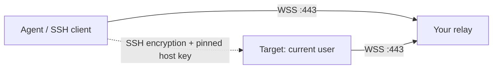

# ShellPier

[](https://github.com/Boulea7/shellpier/actions/workflows/ci.yml)
[](LICENSE)

Temporary SSH access for agents, across machines and networks.

[Download](https://github.com/Boulea7/shellpier/releases) · [中文指南](README.zh-CN.md) · [Workflows](docs/workflows.md) · [Deployment](docs/relay.md) · [Troubleshooting](docs/troubleshooting.md) · [Install / offline](docs/install.md) · [Compatibility](docs/compatibility.md) · [Research](docs/research.md) · [Security](SECURITY.md)

ShellPier runs an SSH endpoint as the current user and connects it outward to a relay over WebSocket. It needs no system SSH server or administrator account. Sessions expire; stopping the host revokes the session. It runs in the foreground by default and does not install an autostart service.



| Your machine | Start here |
|---|---|
| Windows 10/11 | Extract native archive; PowerShell `.\shellpier.exe`, CMD `shellpier.exe` |
| Windows 7/8 | [Separate legacy PowerShell/Bitvise entrypoint](docs/legacy-windows.md) |
| macOS / Linux | Extract native archive; `./shellpier` |

## Get connected

You need a relay URL and creation key from your team or your own relay. **No public free relay is bundled.** See [the relay guide](docs/relay.md). Download an archive from this repository's Releases, check its SHA-256 against `checksums.txt`, and extract it. The archive contains the executable, legacy Windows entrypoint, skill, and license.

The examples below assume `shellpier` is on PATH. Otherwise use the executable paths in the table above. On the target:

```sh
shellpier doctor --relay https://relay.example.com
shellpier share --relay https://relay.example.com --ttl 1h --output access.json
```

Set `SHELLPIER_RELAY_KEY` privately, or supply `--token-file /private/path/relay.key`. `SHELLPIER_RELAY_URL` can provide the default relay URL. Transfer `access.json` privately to the controller. It contains a temporary private key and must not enter chat transcripts, Git, or build logs.

Windows PowerShell, from the extracted directory (quote `@file` arguments):

```powershell
.\shellpier.exe doctor --relay https://relay.example.com
.\shellpier.exe share --relay https://relay.example.com --ttl 1h --output access.json
# On the controller after privately transferring the file:
.\shellpier.exe connect '@access.json' -- hostname
.\shellpier.exe connect '@access.json' -- whoami
.\shellpier.exe ssh-config '@access.json' --out .\session-ssh
# For an invitation target:
.\shellpier.exe host '@host.ticket'
```

CMD uses `shellpier.exe connect @access.json -- whoami` from the extracted directory. The modern installer requires PowerShell 5.1+; the legacy package is a separate entrypoint and does not depend on Invoke-WebRequest.

On the controller:

```sh
shellpier connect @access.json -- hostname
shellpier connect @access.json -- whoami
shellpier ssh-config @access.json --out ./session-ssh
```

The generated SSH configuration pins the session host key and uses an isolated identity and known-hosts file. Use `ssh -F ./session-ssh/ssh_config shellpier hostname` or `sftp -F ./session-ssh/ssh_config shellpier`; keep the entire directory private. Built-in `connect` works without OpenSSH.

For a controller-created invitation:

```sh
shellpier invite --relay https://relay.example.com --ttl 1h --out ./invitation
# Send only host.ticket to the target, then run there:
shellpier host @host.ticket
# Keep access.json and the generated private-key files on the controller.
shellpier connect @invitation/access.json -- hostname
```

Stop the foreground process with Ctrl+C, or use `shellpier stop --state <printed-state.json-path>`. Inspect `shellpier status --state <printed-state.json-path>` before stop; runtime state is removed when the session closes. For an invitation, `shellpier revoke @invitation/host.ticket` also revokes remotely. Verify a fresh connection fails after stopping or expiry, then run `shellpier cleanup --dir ./invitation` (or `./session-ssh`) to remove generated credentials. Cleanup preserves unrelated files and does not itself revoke access. Existing commands are never replayed automatically after a disconnect.

## Choose your path

| Environment | Path | Boundary |
|---|---|---|
| Windows 10/11, Linux, macOS | Native executable | Current-user command execution and SFTP; no PTY or desktop control |
| Windows 7/8 | [Legacy Windows package](docs/legacy-windows.md) | Separate PowerShell/Bitvise workflow; modern Go executable is not supported here |
| Agent with an SSH tool | `ssh-config` + `proxy` | Requires an OpenSSH-compatible client |
| Restricted network | HTTPS/WSS relay on 443 | Normal portal login and network authorization still apply |

Use `--keep-awake` only when desired; availability depends on the OS. Direct listening with `--listen 0.0.0.0:0` needs an allowed inbound route and exposes a temporary endpoint. Prefer the relay for outbound-only networks.

## Develop

Go 1.26 or newer is required by current dependencies.

```sh
go test ./...
go test -race ./...
go build ./cmd/shellpier
python3 scripts/validate_skills.py
```

CI is configured for Linux, macOS and Windows tests, race checks, repeated tests, build smoke tests, vulnerability checks, and skill validation. Configuration alone is not a claim that hosted jobs have passed. See [CONTRIBUTING](CONTRIBUTING.md) and [the command reference](docs/commands.md).

MIT © Boulea7. Use only on systems you are authorized to access.
