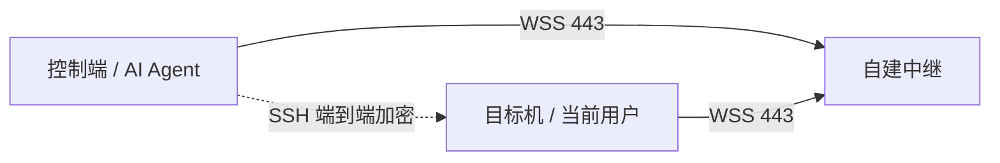

# ShellPier 文档

[返回项目首页](../README.md) · [English quick start](../README.en.md)

## 开始使用

| 你想做什么 | 从这里开始 |
|---|---|
| 选择安装包或离线复制 | [安装](install.md) |
| 单机演练、局域网或校园网连接 | [使用场景](workflows.md) |
| 查询参数、传文件、生成密钥 | [命令手册](commands.md) |
| 给 Codex / Claude Code 提供操作指引 | [Agent skill](../skills/shellpier/SKILL.md) |
| 使用 Windows 7 / 8 | [Legacy Windows](legacy-windows.md) |
| 诊断连接失败 | [排障](troubleshooting.md) · [常见问题](faq.md) |

## 理解与部署

双方主动连接中继，SSH 命令与文件在两端之间加密；中继负责配对连接。局域网模式可直接连接目标机。

- [中继部署](relay.md)：本地演练、TLS、容器与运行限制。
- [兼容性](compatibility.md)：系统要求、已测试的平台与会话结束行为。
- [方案调研](research.md)：同类工具与故障经验。
- [安全策略](../SECURITY.md)：权限模型与漏洞报告。

## 参与开发

[贡献指南](../CONTRIBUTING.md) · [架构与扩展](development.md) · [路线图](roadmap.md) · [更新记录](../CHANGELOG.md) · [获取帮助](../SUPPORT.md)
